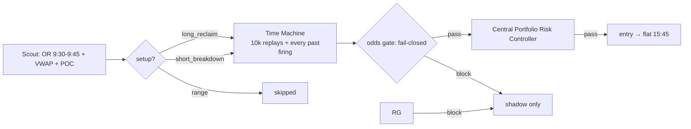
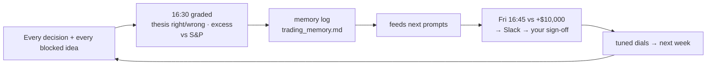
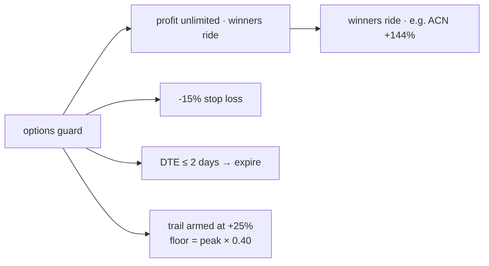
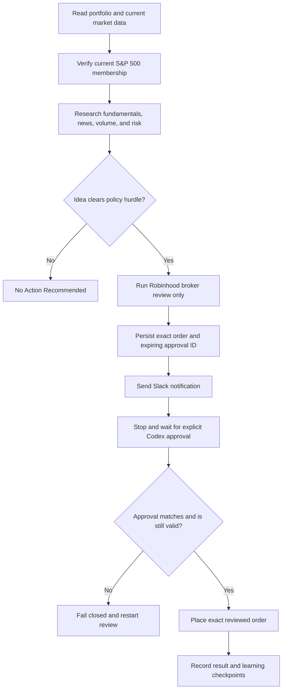

# AI Trading Desk

[](https://github.com/Danisosei20/ai-cio-trading-ops/actions/workflows/ci.yml)
[](LICENSE)
[](pyproject.toml)

An autonomous, safety-gated **multi-agent trading desk**: AI analysts debate, a deterministic risk engine disposes, and every decision lands in an auditable ledger. Paper-first on Alpaca — live Robinhood stays behind explicit human approval, always.

## OpenAI Policy

**This desk does not use OpenAI.** All judgment runs on NVIDIA NIM hosted models
(`nvidia/nemotron-3.5-lightning-30b-a3b`). The OpenAI key is commented out in
`.env` and is not used for any judgment, research, or execution path.

> **Not financial advice.** Research software. Strategies can and do lose
> money; backtested edges routinely die out-of-sample (ours publish their
> failures too).

---

## Quick Start

```bash
git clone https://github.com/Danisosei20/ai-cio-trading-ops.git
cd ai-cio-trading-ops && cp .env.example .env   # no secrets in git, ever
```

Then edit `.env` with your Alpaca paper keys, Slack webhook, and other settings.
Never commit `.env` — it is git-ignored.

Run the full test suite:

```bash
python3 -m unittest discover -s tests   # 358 tests, all green
```

Run preflight before any trading session:

```bash
python3 scripts/preflight.py            # 9 checks, all must PASS
```

---

## Architecture

The desk is a set of scheduled, independent loops that share a single Central
Portfolio Risk Controller. No strategy can place a broker order without passing
through the risk gate.

### Scheduled tasks (9, weekdays, ET)

| Time | Task | Purpose |
|------|------|---------|
| 09:35 | `AI-Desk-OvernightExit` | Sell overnight positions at open |
| 09:45 | `AI-CIO-AutoTrade-0945` | Swing debate → screen 7 names → gate → paper orders |
| 09:50 | `AI-Desk-Watchdog` | Verify the 09:45 run completed |
| 10:00–15:30 | `AI-Desk-IntradayLoop` | Continuous scan every 45 min → judge → enter |
| 15:10 | `AI-Desk-OptionsWatch-1510` | Options entries (zone-gated) |
| 15:40 | `AI-Desk-OvernightEnter` | NVDA overnight gap capture (backtested edge only) |
| 15:45 | `AI-Desk-Flatten-1545` | Flatten all day trades before close |
| 16:30 | `AI-Desk-ScoreShadows-1630` | Grade shadows, settle memory |
| Fri 16:45 | `AI-Desk-WeeklyReview-1645` | Weekly scorecard vs $10k objective → Slack |

### Pipeline diagram

```mermaid
flowchart TD
    SC[Screener: top 10 → top 7] --> Z[Zone scan: POC · VA · VWAP · EMA 9/21 · S/D]
    Z --> DEB[TradingAgents debate\n 2 analysts (market, news) → bull vs bear → manager (NIM lightning-30b)]
    DEB --> G1{Gates}
    G1 -- desk cross-check --> G2{regime CHOP/TREND}
    G2 --> G3{session 09:45–15:45 + clock}
    G3 --> G4{zone verdict}
    G4 --> G5{odds gate (day trades)\n ≥40% stop / <20% target → block}
    G5 --> G6{risk caps · position limits · kill switch}
    G6 -- all pass --> ORD[Alpaca PAPER order\n → Slack rationale → /trading page]
    G1 -- any FAIL --> SHADOW[shadow row, no order (fail-closed)]
    G2 -- FAIL --> SHADOW
    G3 -- FAIL --> SHADOW
    G4 -- FAIL --> SHADOW
    G5 -- FAIL --> SHADOW
    G6 -- FAIL --> SHADOW
```

### Day-trade path (10:00–15:30, long + short)



Long setups: opening range reclaim above VWAP, EMA 9/21 bullish continuation, demand-zone bounce.
Short setups: opening range breakdown below VWAP, EMA 9/21 bearish continuation, supply-zone rejection.
Short trading requires confirmed broker eligibility and borrow availability — easy-to-borrow securities only.

### Self-learning loop



### Guard exits (options guard, runs at 09:45)



**Important:** Options trading has **no fixed take-profit target** by default — winners run unlimited. The -15% stop is a stop-loss, not a guaranteed exit price during gaps or illiquid trading. A trailing stop armed at +25% locks in at least +40% of peak profit (floor = peak × 0.40).

---

## Project Layout

```
scripts/
  auto_trade_weekday.bat     09:45 swing debate run
  daytrade_engine.py         Autonomous long/short day-trade engine
  daytrade_backtest.py       Intraday backtest engine (costs, slippage, borrow)
  daytrade_scout.py          OR + VWAP + zone scout with Time Machine odds
  intraday_loop.py           Continuous intraday scan loop (state machine)
  options_pilot.py           Options entry execution
  options_guard.py           Options exit guard (+2%/-25%/DTE/trail)
  options_watch_trade.py     15:10 options watch loop
  overnight_pilot.py         Overnight gap capture (NVDA only)
  preflight.py               9-check system health
  trading_state.py           /trading page state assembler
  desk_metrics.py            Risk-adjusted metrics (Sharpe, Sortino, MDD, PF)
  desk_report.py             Combined metrics + confidence report
  portfolio_risk_check.py    CLI gate for central risk controller
  settle_memory.py           Self-learning memory consolidation
  zone_analysis.py           POC/VA/VWAP/EMA 9/21/supply-demand zones
  flatten_daytrades.py       15:45 flatten safety net
  ...
robinhood_tools/
  portfolio_risk.py          Central Portfolio Risk Controller (atomic, fail-closed)
  trade_state.py             Trade state machine (SCANNING → ... → CLOSED)
  confidence.py              Observational setup scoring + champion/challenger
  alpaca_paper.py            Alpaca paper-only HTTP transport and backend
  ...
tests/
  test_daytrade_engine.py    20 tests
  test_daytrade_backtest.py  11 tests
  test_trade_state.py        10 tests
  ...                        358 total, all green
web/agent-office/
  trading.html               /trading dashboard (long/short, P/L, scorecard)
  pipeline.html              /pipeline diagram
```

---

## Configuration

Personal values live in the git-ignored `.env` file. Copy `.env.example` when setting up another machine:

```bash
cp .env.example .env
```

Then edit `.env` with your Alpaca paper keys, Slack webhook, NVIDIA NIM key, and other settings. Never put Robinhood account numbers, passwords, cookies, access tokens, recovery codes, or live-broker API keys in `.env`.

Important settings include:

- `TRADINGAGENTS_QUICK_THINK_LLM` / `TRADINGAGENTS_DEEP_THINK_LLM` → `nvidia/nemotron-3.5-lightning-30b-a3b` (no OpenAI)
- `NVIDIA_API_KEY` — required for judgment
- `FRED_API_KEY` — macro analyst data
- `MAX_RISK_PCT_PER_TRADE` → 0.0025 (0.25% per trade)
- `MIN_REWARD_TO_RISK` → 1.5
- `MAX_DAY_TRADES` → 2
- `MAX_TOTAL_NOTIONAL` → 5000

---

## Safety Model

A real order requires all of the following:

1. Pass the Central Portfolio Risk Controller (atomic, fail-closed).
2. Pass the Time Machine odds gate (fail-closed on tool errors).
3. Pass the zone gate (POC/VA/VWAP/EMA 9/21/supply-demand).
4. Pass the regime gate (CHOP blocks new buys).
5. Circuit breaker: if equity is down >2% from previous close, all buys blocked.
6. Explicit approval for live orders; paper mode is the default.

Slack is notification-only. It never authorizes execution.

Paper mode uses separate Alpaca paper credentials, storage, and simulated broker fills. Live mode never uses a configuration variable as execution authority — every live buy, trim, or sell still needs a fresh broker review and explicit matching approval.

---

## One-Task Trade Lifecycle

Each active symbol has one durable lifecycle whose task name is exactly the uppercase ticker (for example, `NVDA`). Duplicate lifecycle creation is blocked. The task progresses through research, buy approval, open position monitoring, sell approval, filled sale, realized-profit Slack notification, and learning checkpoints.

Profit alone is not a sell signal. The exit evaluator considers thesis status, valuation, concentration, target return, retracement from the peak, and upcoming binary events. Any resulting trim or sale is review-only until the broker preview and matching Codex approval are complete.

---

## Investment Policy

### Eligible purchases

Only companies verified as current S&P 500 constituents may be purchased. Membership is dynamic, so the host must supply a current sourced snapshot instead of relying on a permanent hard-coded list.

Existing holdings outside the index may be held, trimmed, or sold to exit legacy exposure, but cannot be purchased or increased.

### Research requirements

Every candidate should include:

- A current broker quote with timestamp and source
- Current company news
- A current company filing, SEC filing, or investor-relations source
- At least one additional independent reliable source
- A clear thesis and counterargument
- Expected reward/risk better than 2:1
- Portfolio, concentration, and tax impact

### Volume and execution analysis

The workflow records:

- Current session volume
- 20-day and 50-day average volume
- Relative volume
- Average daily dollar volume
- Bid/ask spread
- Proposed order size relative to average volume
- Expected slippage
- Whether volume confirms or contradicts the price move

These signals provide confirmation and risk context. They are not standalone instructions to buy or sell.

### Profitable positions

The full portfolio is reviewed using cost basis, unrealized return, holding period, tax impact, thesis status, valuation, concentration, and position-specific targets.

A positive return triggers analysis—not an automatic sale. A trim or sale still requires broker review, a Slack notification, and explicit matching approval in Codex.

---

## Approval Lifecycle



## System Components

- `PortfolioRiskController` — single gate between all strategies and Alpaca (atomic, fail-closed)
- `TradeStateMachine` — persistent trade lifecycle with restart recovery
- `SetupScorer` — observational setup scoring (0-100), per-strategy tracking, champion/challenger
- `Time Machine` odds grader — 10,000-session Monte Carlo replay + historical setup firing, fail-closed on errors
- `Zone scanner` — POC/VA/VWAP/EMA 9/21/supply-demand confluence
- `CioDatabase` — SQLite transactions with `BEGIN IMMEDIATE` execution reservation
- Structured JSON logs include correlation and approval IDs while excluding credential-like fields

---

## Running the Tests

The test suite uses the Python standard library and does not contact Alpaca or Robinhood or place orders.

```bash
python3 -m unittest discover -s tests
```

358 tests, all green. The suite covers account restrictions, broker-review requirements, approval expiry, order tampering, duplicate execution, S&P 500 purchase restrictions, Slack delivery records, message formatting, learning-journal fields, trade state machine transitions, position sizing, reward-to-risk validation, odds-gate fail-closed behavior, risk controller atomicity, backtest aggregation, and more.

---

## CLI

Install the project or use the module directly:

```bash
python3 scripts/preflight.py                    # 9 system health checks
python3 scripts/portfolio_risk_check.py --symbol NVDA --side buy --notional 500 --strategy overnight
python3 scripts/portfolio_risk_check.py --engage-kill
python3 scripts/portfolio_risk_check.py --clear-kill
python3 scripts/portfolio_risk_check.py --status
python3 scripts/desk_report.py                  # metrics + confidence + champion/challenger
python3 scripts/daytrade_backtest.py            # intraday backtest engine
python3 scripts/daytrade_engine.py --dry-run    # scan + judge, no orders
python3 scripts/intraday_loop.py                # continuous scan loop
python3 scripts/trading_state.py                # /trading page state
```

There is intentionally no casual `buy` command.

---

## Small-account safety profile

The checked-in live policy limits new orders and total symbol exposure to $25. Autonomous Alpaca paper mode permits up to $500 per order and $500 total exposure to one symbol. Both preserve at least $50 cash, permit one open position, stops new entries after $5 daily or $10 weekly realized loss, blocks entries within five days of earnings, and applies a five-trading-day cooldown after an invalidated loss. Risk-off markets require a higher candidate score, and all critical data inputs must be present and fresh.

`emergency-stop` durably blocks new reviews and placements. It does not cancel orders or liquidate positions. Only an explicit operator action may call `emergency-resume`. Paper and live modes use separate databases and dashboards under `outputs/paper/` and `outputs/live/`.

---

## Recovery and immutable audit

Back up the database before every migration. Export approvals, research snapshots, fills, lifecycle events, and learning records; the adjacent SHA-256 file detects changes. Encrypt backups using operating-system or organization-approved encrypted storage and never commit them.

Test recovery quarterly on a clean machine: install from the lockfile, restore the correct paper or live database, run integrity checks, verify schema and required tables, resume unexpired Slack monitors, render the dashboard, and keep live trading disabled until every check passes.

---

## CI and Quality

GitHub Actions installs the exact top-level development tool versions and audited transitive security floors, then runs unit/integration tests, Ruff, mypy, coverage, configuration validation, dependency audit, and local secret scanning. Dependabot checks Python and GitHub Actions dependencies weekly. Run the dependency-free local subset with:

```bash
python3 -m unittest discover -s tests
```

## Health Check

For Alpaca paper mode, first run the read-only broker check:

```bash
python3 -m robinhood_tools.cli paper-broker-health
```

For Robinhood live mode, after the host independently verifies Robinhood read access, run:

```bash
make health
```

## Local Dashboard

Generate a read-only operational dashboard:

```bash
python3 scripts/trading_state.py
```

Or visit `http://localhost:8766/trading` when the office viewer is running.

## License

Apache 2.0 — see [LICENSE](LICENSE). Research software, provided as-is; see [SECURITY.md](SECURITY.md) for reporting security issues privately.